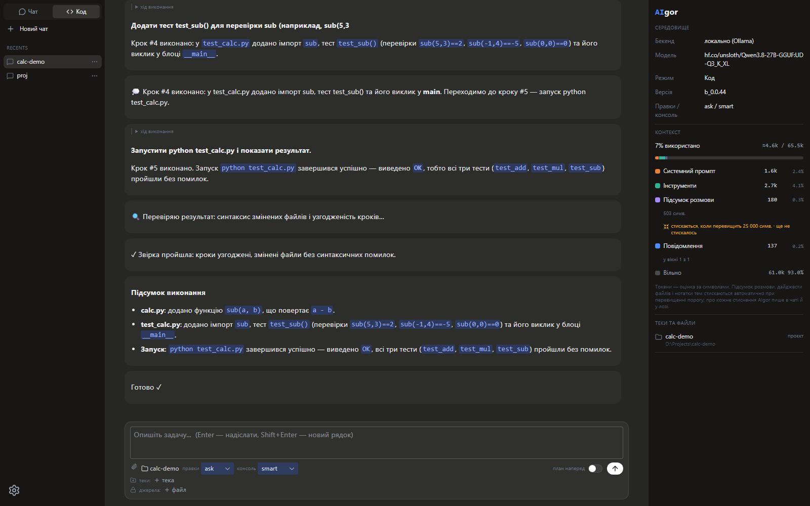

# AIgor

*Українською — [README.uk.md](README.uk.md).*

**A desktop coding agent built for weak and mid-size open LLMs.** It runs on a 27B model quantized to fit a 16 GB
consumer GPU (Qwen3.8-27B via Ollama) or on any OpenAI-compatible server (vLLM, DeepSeek, …), and still works on
real projects with large files. It doesn't rely on the model keeping everything in its window. The planner splits
work into narrow steps, context lives in files, compression always leaves a pointer back to the original, and the
model searches instead of reading whole files.



*A 5-step plan executed by Qwen3.8-27B on a local GPU: each step reports exact facts, the planner reviews them,
then a syntax + consistency check and a final summary.*

> **Status:** an actively developed personal project, Windows-first. **The UI is in Ukrainian for now**; the code,
> prompts and this documentation are usable in English. **English localization of the UI is on the roadmap.** If you
> would use it, open an issue or star the repo, since interest decides the priority. Issues and PRs are welcome.

## Why

Strong hosted models can hold a whole repository in their head. Open models you can run yourself usually can't:
they lose track in long tool loops, retype data they shouldn't touch, and overflow their context. AIgor is built
around those limits instead of hoping they go away:

- **Planner → narrow steps.** One structured call decides what the request is (answer / just run / clarify /
  plan) and splits the task into a few coarse steps. Each step runs in its own short tool loop with a narrow context.
- **Facts, not retellings.** After each step the planner sees exactly which commands ran with their output and which
  files changed, collected by code rather than the model's summary, and it can revise the plan. At the end it runs
  a syntax + consistency check and writes a summary of what was actually done.
- **Search first.** `search` returns `path:line: text`; `read_file(path, start_line, limit)` reads only the
  needed lines. Small edits use `replace_in_file` (old → new, no second model pass over the file).
- **Context in files, compression with an address.** Long command output goes to a file, and the context gets the
  head, tail and file path. Old tool results are compacted to a short head plus the exact call that brings the
  original back. Conversation history stays on disk (`recall_history`); notes and topics are files (`recall`). The
  conversation summary is lazy: recent turns stay verbatim, and only what falls out of the window gets summarized.
- **Large opaque literals never pass through the model.** Protobuf blobs, keys and base64 are cut out into
  placeholders before the model sees the file and restored byte-for-byte afterwards.
- **One loop, many safeguards.** Code steps, chat, analysis and the research sub-agent share one loop core with loop
  detection (`LoopGuard`), a "reading without acting" limit, a forced conclusion, and compaction before the window
  overflows.
- **Cache-friendly prompts.** Stable context comes first, and the changing plan goes last. On vLLM this cuts prefill
  time on steps 2+ by about 36–43% (measured: `scripts/bench_context_order.py`).

More detail: [docs/ARCHITECTURE.md](docs/ARCHITECTURE.md).

## Features

- **Code mode:** plan → steps → verification, with edits shown as diffs. Editing permission is `ask` or `auto`;
  shell permission is `smart` (dangerous commands need confirmation), `ask`, `auto`, `allowlist` or `off`.
  You can comment while a plan is running: the executor sees your comment between actions, and the planner sees it
  after the step. A failed step pauses the plan, and "Run" resumes from that step.
- **Chat mode:** a thinking model with web search and read tools; topics persist across chats.
- **Attachments and images:** files are stored on disk and read by name. Small ones are inlined; large ones are read
  in chunks with a digest.
- **Context panel:** shows what occupies the model window, plus project folders and git changes.
- **Backends:** local Ollama (one model for all roles, window size from settings) or any OpenAI-compatible server,
  with saved server profiles. "Strict" mode supports servers without vLLM extensions, such as DeepSeek.
- **Self-update** from GitHub Releases (SHA-256 checked), **diagnostics export**, and logs without your prompts or
  keys.

## Quick start (Windows)

1. Download `Igor.exe` from [Releases](https://github.com/MagestiUA/AIgor/releases/latest). It is a single file,
   with nothing else to install. SmartScreen may ask: *More info → Run anyway*.
2. **Settings** (gear, bottom-left) → *LLM connection*:
   - **Local:** install [Ollama](https://ollama.com), pull a model (default
     `hf.co/unsloth/Qwen3.8-27B-GGUF:UD-Q3_K_XL`, about 15 GB, fits 16 GB VRAM at a 64k window), pick *Local*.
   - **Server:** enter host, port, API key, then *Check* → *Save*.
3. **Code** mode → choose the project folder → describe the task.

Commit your work before you start: AIgor edits files in the chosen folder. Your data (chats, settings) lives in
`%USERPROFILE%\.local-code-agent\`.

## Run from source

```powershell
py -3.12 -m venv .venv
.venv\Scripts\pip install -r requirements.txt
.venv\Scripts\python main.py          # desktop window (pywebview)
```

Run a task without the UI through the same code path as the app, with metrics (use a copy of the project):

```powershell
.venv\Scripts\python scripts\run_task.py --root D:\copy-of-project "add function X to a.py"
```

## Tests

About 70 offline test scripts with stub models (no GPU), on the same limits the app uses:

```powershell
$env:PYTHONIOENCODING="utf-8"; .venv\Scripts\python tests\run_all.py -j 4
```

## Layout

```
agent/           the agent core (no UI)
  steploop.py      the single "model → tools" loop (hooks for UI / headless / sub-agent)
  plan_runner.py   plan execution: steps, planner review, verification, summary
  planner.py       routing + planning in one structured call
  toolkit.py       tool registry (search, read_file, replace_in_file, edit_file, run_shell, …)
  convo.py         lazy conversation summary + verbatim tail
  literals.py      strip / restore of large literals
  loopguard.py     loop detector
  headless.py      the agent without UI (for scripts and task runs)
lca_web/         Reflex UI (state.py: state + adapters to the core; ui.py: layout)
scripts/         release, headless task runs, benchmarks
tests/           offline tests
docs/            architecture (EN) and developer notes (UK)
```

## Contributing

See [CONTRIBUTING.md](CONTRIBUTING.md). Code comments and some docs are in Ukrainian; English PRs and issues are
fine.

## License

[MIT](LICENSE)
